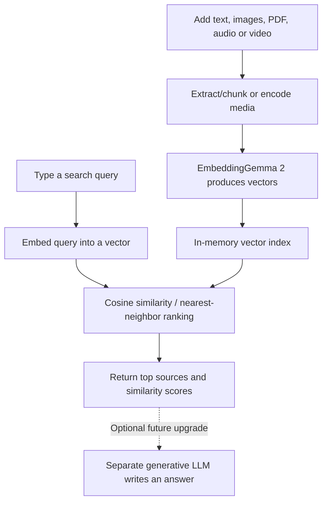

# EmbeddingGemma 2 Playground — Practical Testing Guide

**Model:** [google/embeddinggemma-2](https://huggingface.co/google/embeddinggemma-2)  
**Application:** EmbedLab — EmbeddingGemma 2 Playground  
**Goal:** Learn how a multimodal embedding model represents content and retrieves semantically related material.

## 1. First: what this playground does (and doesn't do)

**EmbeddingGemma 2 is not a conversational LLM.** It converts inputs into *embedding vectors* (lists of numbers). Your playground compares those vectors to find relevant content.

For example, you can upload a report that says:

> The hydraulic pump stopped because of excessive temperature and insufficient lubrication.

Then search:

> Why did the drilling equipment break down?

A successful semantic search retrieves the report **despite the different wording**. The playground displays the retrieved text or file and a ranking score; it **does not create a new explanation**. To generate an answer, you would connect a separate LLM (for example, Qwen) to those retrieved results.

### Pages in the application

| Page | What to use it for |
|---|---|
| **Playground** | Enter a question/query and inspect retrieved sources, their ranking and scores. |
| **Similarity lab** | Compare two text strings to see their embedding similarity. |
| **Knowledge base** | Paste text/code, upload files and inspect the current source collection. |
| **Model guide** | Review capabilities and embedding concepts. |

## 2. Start the application

Run the commands from the `embeddinggemma2-playground` folder:

```bash
python -m venv .venv
source .venv/bin/activate           # macOS / Linux
python -m pip install -r requirements.txt
python -m uvicorn server:app --reload
```

Open **http://127.0.0.1:8000**.

> **Important: demo vs real inference**  
> The UI starts in **Demo mode**, which uses a simple lexical/keyword demonstration. That is **not** EmbeddingGemma 2. Click **Load real model** in the top-right and confirm the badge becomes **Real model** before judging semantic or multimodal performance. The first load downloads the model from Hugging Face and can require a substantial download and compatible Python ML packages.

If startup reports `Form data requires "python-multipart"`, run:

```bash
python -m pip install python-multipart
python -m uvicorn server:app --reload
```

On macOS, if Conda `(base)` and `(.venv)` are both displayed, use `python -m pip` and `python -m uvicorn` so installation and execution use the same interpreter.

## 3. Test A — Text semantic retrieval (start here)

1. Open **Knowledge base** in the left sidebar.
2. In **Source title**, enter `Drilling Equipment Incident`.
3. In **Text or code**, paste:

   ```text
   The hydraulic drilling pump stopped operating after its temperature
   exceeded 120 degrees Celsius. Engineers identified insufficient
   lubrication as the primary cause of failure.
   ```

4. Click **Add text source**. Verify the item appears under **Sources**.
5. Open **Playground**. Search:

   ```text
   Why did the drilling equipment break down?
   ```

6. Inspect the returned source, excerpt and similarity score.

**What to expect:** The incident report should be relevant, even though the question and document do not have identical wording. Results depend on other indexed documents and the model. The system should return evidence, *not* write its own diagnosis.

**Better test:** Add two more documents about unrelated subjects (e.g. food and finance) and see whether the drilling report ranks highest. A single indexed document is a weak test: it may rank first simply because there is no alternative.

## 4. Test B — Text-to-image retrieval

Download or use your own **three different photographs**:

- A dog (`dog.jpg`)
- A cat (`cat.jpg`)
- A car (`car.jpg`)

Then:

1. Go to **Knowledge base** → **Choose a file to embed**.
2. Upload each image separately. Supported extensions: `.png`, `.jpg`, `.jpeg`, `.webp`.
3. Confirm all three appear in **Sources**.
4. Return to **Playground** and search `Find a picture of a dog`.
5. Try `Find a vehicle` and compare results.

**What to expect:** With **Real model** active, the dog image should generally rank well for the first query and the car for the second. This is **cross-modal retrieval**: text and images are embedded into a comparable vector space. Performance is not guaranteed for every image or prompt.

**Important:** Don't interpret a top-ranked image as proof the model understood every detail. It is a similarity ranking, not a factual caption or visual reasoning answer.

## 5. Test C — PDF, code, audio and video

Use the same **Knowledge base** → **Choose a file to embed** control.

| Input | Supported format in this prototype | Example search | Caveat |
|---|---|---|---|
| **PDF report** | `.pdf` | `Find the section about equipment failure` | Extractable text only; no OCR for scanned pages. |
| **Code** | Paste code into **Text or code**, or upload `.txt`/`.md` | `Find the function that validates login` | Finds related content; it does not execute or audit code. |
| **Audio** | `.wav`, `.flac`, `.mp3` | `Find the sound of rainfall` | Depends on installed audio codec support and real model loading. |
| **Video** | `.mp4`, `.mov`, `.webm` | `Find footage showing traffic` | May need additional codec support; not a full video understanding pipeline. |
| **Mixed inputs** | Any combination above | `Find offshore drilling equipment` | Results can include multiple modalities if the relevant source content is indexed. |

**Upload limit:** 15 MB per file in this prototype. Audio/video support may require optional packages (e.g. `soundfile` or `torchcodec`) and system codec dependencies. Do not assume success until the file appears in **Sources** and real-mode retrieval returns it.

## 6. Test D — Similarity lab

Open **Similarity lab** and compare:

| Text A | Text B | General expectation |
|---|---|---|
| `The automobile needs maintenance.` | `The car should be serviced.` | Relatively high semantic similarity. |
| `The borehole pressure is elevated.` | `The well has high pressure.` | Relatively high semantic similarity. |
| `The server ran out of memory.` | `I want chicken rice.` | Lower semantic similarity. |

Try different **embedding dimensions**: 128, 256, 512 and 768. Smaller vectors reduce storage and comparison costs, but can change ranking quality. **Don't treat cosine similarity as a probability of correctness.**

## 7. How retrieval works internally



- **Ingestion:** Content is parsed/chunked where applicable and transformed into embeddings.
- **Indexing:** The vectors are kept in memory in this educational application.
- **Query:** Your search is also embedded.
- **Retrieval:** The app compares the query vector with indexed vectors and returns the closest matches.
- **Generation:** **Not included**. An LLM is necessary for synthesized, conversational answers.

## 8. A useful multimodal experiment

Create a mini *offshore operations* collection:

1. Upload an **offshore oil rig photograph**.
2. Add **text** describing offshore platform maintenance.
3. Upload a **text-based PDF** explaining equipment inspections.
4. Search: `Find information about offshore platforms`.
5. Observe whether multiple content types appear and which ones rank highest.

Now ask: `Analyze the safety risks of this offshore platform.`

The playground may retrieve related content, **but it will not perform a safety assessment**. Retrieval and reasoning are different capabilities.

## 9. Troubleshooting and limitations

- **Only Demo mode appears:** Click **Load real model**; confirm the model actually initializes. Demo results are keyword-based.
- **Upload fails:** Make sure the backend is running, `python-multipart` is installed, the extension is supported and the file is <= 15 MB.
- **Scanned PDF gives poor/no text:** This app does not provide OCR; use a text-based PDF.
- **Audio/video errors:** Check codecs and optional dependencies for your environment.
- **Everything ranks similarly:** Add distinct alternatives and test clearer queries. A high similarity score is not an accuracy guarantee.
- **Documents disappear after restarting:** The index is **in memory**. The prototype does not persist and reload its index as a production vector database would.
- **First real-mode load fails:** Model inference was not verified against downloaded weights in the packaged environment. Check Hugging Face access, available memory, dependency versions and backend logs.
- **Sensitive information:** Don't upload secrets or private files; this prototype lacks production-grade authentication and secure data isolation.

## 10. What to learn before adding an LLM

1. **Relevance:** Does the right item rank in the top 1 or top 3?
2. **Semantic generalization:** Can you search with synonyms rather than exact words?
3. **Cross-modal retrieval:** Can a text query find a relevant image?
4. **Dimensional trade-off:** Do results change at 128 vs 768 dimensions?
5. **Failure cases:** Which inputs retrieve the wrong thing, and why?

Once these experiments work, the natural next step is **RAG**:

`Data → EmbeddingGemma 2 → vector search → retrieved evidence → Qwen/another LLM → generated answer with sources`

That is a different application layer. **EmbeddingGemma 2 retrieves meaningfully related information; it does not generate the final answer.**
