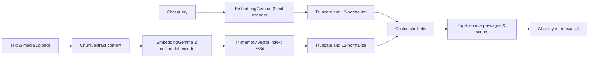

# EmbedLab — EmbeddingGemma 2 Playground

A local, chat-style **retrieval** workbench for [google/embeddinggemma-2](https://huggingface.co/google/embeddinggemma-2). You can open the UI immediately in a browser for a transparent *lexical demonstration* or run the FastAPI backend to download and test **real model embeddings**.

**Important:** EmbeddingGemma 2 is an embedding model, **not a generative chat model**. The chat interface retrieves and ranks source passages. It does **not** invent answers or claim that excerpts are generated by the model. To build a full RAG chatbot, a separate generative LLM must consume the retrieved passages.

## Quick start

Requires **Python 3.10+** and internet access for the **first model download**.

```bash
cd embeddinggemma2-playground
python -m venv .venv
```

Activate the virtual environment:

```bash
# macOS / Linux
source .venv/bin/activate

# Windows PowerShell
.venv\Scripts\Activate.ps1
```

Install dependencies and run:

```bash
python -m pip install -U pip
pip install -r requirements.txt
uvicorn server:app --reload --host 127.0.0.1 --port 8000
```

Open **http://127.0.0.1:8000**. The app initially shows **Demo mode**, which uses basic keyword overlap. Click **Load real model** to download the Hugging Face checkpoint, initialize PyTorch, and embed the seed corpus. When the status becomes **Real model**, all subsequent chat searches and similarity comparisons use the actual checkpoint.

> Want to explore the UI without installing Python? Open `static/index.html` in a local browser. The browser-only demo works on built-in sample text and does not create embedding vectors. Adding `.txt` and `.md` files fills the source editor. Other file types need the backend.

## Test workflows

1. **Retrieval chat:** Ask “How does a model find relevant content without matching the same words?” Inspect retrieved evidence and ranking scores. Real inference uses the model's **SearchQuery** prefix for the query and titled-document formatting for indexed text.
2. **Similarity lab:** Compare “The automobile needs maintenance” vs “The car should be serviced.” Real mode encodes both texts with the symmetric sentence-similarity prefix, then computes cosine similarity.
3. **Matryoshka dimensions:** Switch between 128 / 256 / 512 / 768 before rerunning a query. Both query and stored vectors are truncated and L2-renormalized to the selected dimension.
4. **Custom sources:** Paste a text snippet or upload a TXT, MD, text-based PDF, image, audio or video. The backend extracts text or encodes the media, adding it to the same searchable in-memory index.
5. **Cross-modal retrieval:** Upload an image (e.g. a dog or an offshore platform), then search for it using text. Real mode uses EmbeddingGemma 2's `model.encode({"image": "path/to/file"})` input format. Cross-modal scores are experimental and depend on media and prompts.

### Supported files

| Type | Extensions | Notes |
|---|---|---|
| Text/code | `.txt`, `.md` | Decoded as UTF-8 |
| PDF | `.pdf` | Extractable text only; no OCR / page-image embeddings |
| Images | `.png`, `.jpg`, `.jpeg`, `.webp` | Native image embedding with the model's vision encoder |
| Audio | `.wav`, `.flac`, `.mp3` | Install `soundfile` and `torchcodec` if your environment needs them; support depends on codecs |
| Video | `.mp4`, `.mov`, `.webm` | Install `torchcodec`; local ffmpeg/codec setup may also be required |

**Upload size limit:** 15 MB. Large documents are split into approximately 950-character chunks with 130-character overlap. This is an educational default, not an optimized splitter. Scanned PDFs need OCR, which this prototype intentionally does not provide.

## Architecture



- **Frontend**: HTML, CSS, plain JavaScript; no Node.js or frontend build step.
- **Backend**: FastAPI, NumPy, SentenceTransformers, Hugging Face model.
- **Storage**: In-memory documents and vectors; media file bytes in `.uploads/`. Restarting resets the index to seed documents; uploads from previous runs are not indexed automatically. Do not upload sensitive information.
- **Precision**: `bfloat16` on NVIDIA GPUs that support it; `float32` otherwise (including CPU/most Apple hardware). Avoid `float16` for this model, as the model card warns it may produce invalid embeddings.
- **Vector math**: The full 768d document representations are stored normalized. Retrieval can truncate leading dimensions (128/256/512/768), then always normalize **both** vectors again before dot product. This is necessary for Matryoshka embeddings.

## Commands and test checks

```bash
python -m unittest discover -s tests -v
python -m py_compile server.py
```

Backend endpoints: `GET /api/status`, `POST /api/model/load`, `GET /api/documents`, `POST /api/documents/text`, `POST /api/documents/upload`, `DELETE /api/documents/{id}`, `POST /api/search`, `POST /api/similarity`.

## Limitations

This is a **local prototype**, not a production service:

- Actual checkpoint inference requires the model download (Hugging Face lists roughly 1.5 GB of model weights) and compatible, up-to-date Python ML dependencies. Loading and multimodal encoding have **not been exercised against downloaded weights** in the packaging environment.
- Full model loads all supported modality encoders. CPU inference can be slow. For text-only use cases you can optimize the initialization with `config_kwargs={"vision_config": None, "audio_config": None}`, but doing so disables the image/audio/video playground features.
- The demo's lexical scores are **not** embedding similarity, and every such score is explicitly labeled in the UI.
- Scores are **not probabilities** or answer correctness. Cosine similarity can also be negative.
- No persistent DB, authentication, upload scanning, rate limiting, queueing, streaming progress, reranker, hybrid retrieval, LLM completion, or formal retrieval evaluation dataset.
- This prototype exposes a local server only on `127.0.0.1`. Do not deploy it as-is to a public server.

For production, introduce data isolation, durable vector indexes (e.g. PostgreSQL + pgvector), batch indexing, chunk provenance, retrieval evaluation, access controls, observability, and optionally a separate generative model for grounded answers.

## Official references

- [EmbeddingGemma 2 model card](https://huggingface.co/google/embeddinggemma-2)
- [Google's SentenceTransformers inference guide](https://ai.google.dev/gemma/docs/embeddinggemma/inference-embeddinggemma-with-sentence-transformers)
- [Google's multimodal embedding guide](https://ai.google.dev/gemma/docs/embeddinggemma/multimodal-embeddinggemma-with-sentence-transformers)
